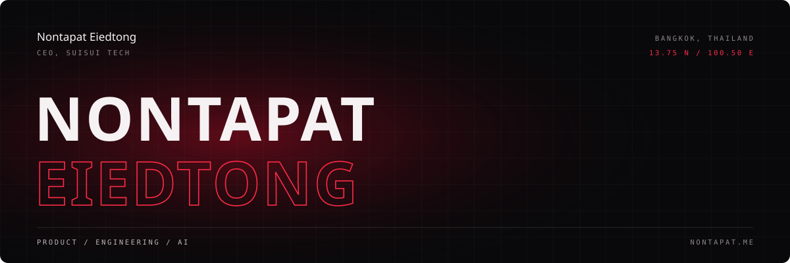
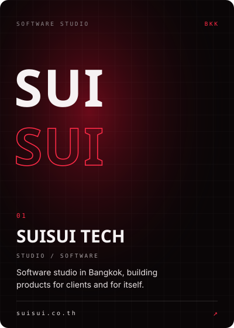
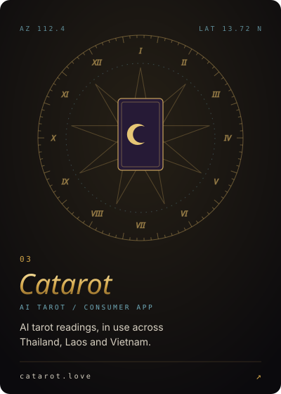

I run [SUISUI TECH](https://suisui.co.th), a software studio in Bangkok, and lead product and engineering on [Catarot](https://catarot.love), an AI tarot app used across Thailand, Laos and Vietnam.

### Selected work

  
  
  

### Stack

TypeScript, React, Node.js, Python, Firebase, Docker

### Contact

[nontapat.me](https://nontapat.me) &nbsp;/&nbsp; [Instagram](https://instagram.com/_mubmib_) &nbsp;/&nbsp; [suisui.co.th](https://suisui.co.th)
